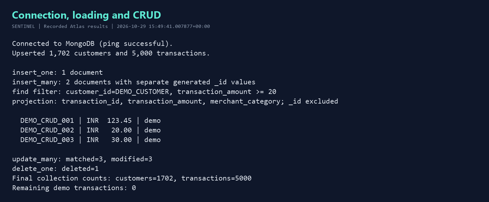
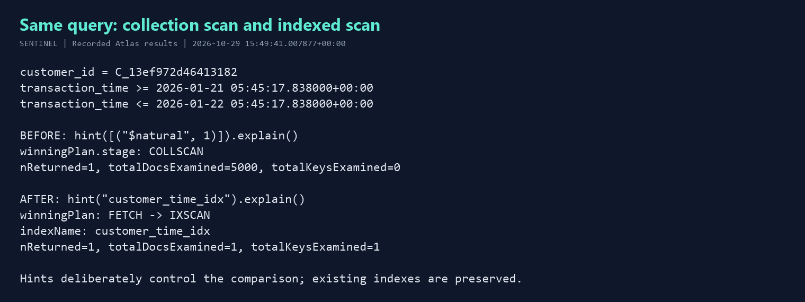
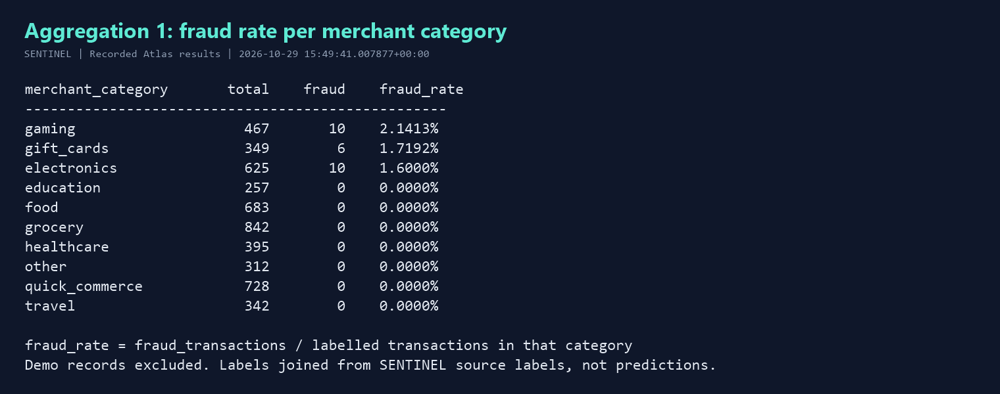
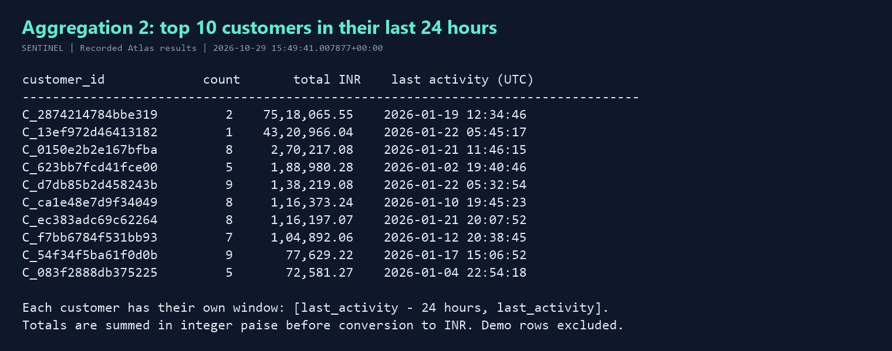

# SENTINEL: MongoDB with Python (Building Blocks)

Model the Project SENTINEL fraud dataset as MongoDB documents and query it with PyMongo. This script implements the required loading, CRUD, indexes, explain plans, and two aggregation pipelines.

## Verified Atlas results

The script was run twice against the configured Atlas database on **29 October 2026**. Both runs produced identical collection counts and aggregation results.

| Check | Observed result |
| --- | --- |
| Connection | MongoClient `ping` succeeded |
| `customers` | 1,702 documents, with embedded device summaries |
| `transactions` | 5,000 Project SENTINEL transactions |
| CRUD | Inserted 1 + 2, found 3 with projection, updated 3, deleted 1 |
| Cleanup | 0 demo records remaining |
| Collection scan | 5,000 documents examined; 1 returned |
| Compound index scan | 1 document and 1 index key examined; same 1 returned |
| Aggregations | 10 merchant categories and top 10 customers |
| Tests | 10 passed, including 4 checks against the real MongoDB server |

See [captured console output](reports/atlas-run.txt), [machine-readable results](reports/atlas-results.json), [rerun results](reports/atlas-rerun-results.json), and [test results](reports/test-results.txt). These files contain no connection URI or credentials.

## 1. Atlas setup

1. Sign in to [MongoDB Atlas](https://www.mongodb.com/atlas/database) and create a **Free / M0** cluster in your project. Follow the [official free cluster setup](https://www.mongodb.com/docs/atlas/tutorial/deploy-free-tier-cluster/).
2. In **Database Access**, create a database user. Give it the `readWrite` role on `sentinel_mongodb`. Atlas account sign-in and database authentication use different users.
3. In **Network Access**, add your current public IP to the project's IP access list. See [Atlas connection security](https://www.mongodb.com/docs/atlas/setup-cluster-security/).
4. Select **Connect > Drivers > Python** and copy the URI. Replace the placeholders locally. URL-encode special characters in the username/password (for example, using `urllib.parse.quote_plus`).
5. Store the URI in `.env`, which is ignored by Git. Commit only `.env.example`.

An existing Atlas connection was used for the recorded run. A successful ping and the CRUD operations verify connectivity and write access; the script does not manage or inspect your Atlas billing tier, database-user configuration, or IP rules.

## 2. Install and configure

Use **Python 3.10+** and a current Atlas cluster. The activity pipeline uses `$setWindowFields` and `$dateSubtract` (MongoDB 5.0+); the optional boundary test uses `$documents` (5.1+).

Windows PowerShell, from this project directory:

```powershell
python -m venv .venv
.venv\Scripts\Activate.ps1
python -m pip install -r requirements.txt
Copy-Item .env.example .env
```

macOS/Linux:

```bash
python3 -m venv .venv
source .venv/bin/activate
python -m pip install -r requirements.txt
cp .env.example .env
```

If you already have `.env`, keep it and update its values rather than overwriting it. The recorded run used Python 3.13.2, PyMongo 4.18.1, python-dotenv 1.2.4, and dnspython 2.8.0.

```dotenv
MONGODB_URI=mongodb+srv://<db_user>:<encoded_password>@<cluster-host>/?retryWrites=true&w=majority
MONGODB_DATABASE=sentinel_mongodb
SENTINEL_DATA_DIR=./data
TRANSACTION_LIMIT=5000
SENTINEL_ACTION=all
```

### Project data provenance

Use the **SENTINEL Project Supabase database kit** supplied in class. The recorded run reads the kit's original gzipped CSV tables locally, which are the source inputs used by the Project's Supabase ingest. It does not generate replacement transactions or call a live Supabase/API endpoint. If you previously ran `sql/create_table` and `python ingest.py all`, point this loader at that same kit's `data` directory.

Extract the class kit so that the configured directory has this structure:

```text
data/
  tables/
    customers/all/*.csv.gz
    devices/all/*.csv.gz
    merchants/all/*.csv.gz
    labels/<split>/*.csv.gz
    transactions/<split>/*.csv.gz
```

The original kit is excluded from Git; obtain it from the Project/class materials after cloning this repository. Set `SENTINEL_DATA_DIR` to its absolute path if it lives elsewhere, for example `D:/datasets/supabase_db_kit/data`. Relative data paths are resolved against `main.py`.

The loader selects the first 5,000 transactions in sorted shard-path and CSV-row order, then joins their customer, merchant, device and label IDs. The recorded sample comes from the first sorted `holdout` transaction shard. This is a reproducible classroom sample, not a representative fraud estimate. The supplied data is synthetic; `amount_paise` is authoritative and the currency is INR.

## 3. Run

```bash
python main.py --action all --report reports/atlas-results.json
```

This connects, validates the source, upserts the sample, demonstrates CRUD, compares explain plans, runs both pipelines, and prints collection counts. At least 5,000 source rows are required; missing joins, invalid dates or missing/bad fraud labels stop the import before database writes.

You can also run individual parts:

```bash
python main.py --action load --limit 5000
python main.py --action crud
python main.py --action explain
python main.py --action aggregate
```

`--data-dir`, `--limit`, and `--action` override their environment defaults. A larger `--limit` needs enough source transactions. Loading uses unique stable-ID indexes and batched upserts, so repeating the same import preserves counts. Loading a different/larger sample adds or updates its records; it does not clear existing data. Aggregations cover all non-demo transactions currently in the collection.

Only these two collections are created:

| Collection | Main fields and BSON types |
| --- | --- |
| `customers` | `customer_id` string, `created_at` Date, `customer_age` integer, `home_city`, `region`, `is_synthetic` boolean, `devices` array |
| `transactions` | Stable ID strings, `transaction_time` Date, `amount_paise` integer, `transaction_amount` number, `merchant_category`, numeric `fraud_label`, nested `customer`, `merchant`, `device` snapshots |

## 4. Document design: embed and reference

Customer example (timestamps are displayed as ISO strings here, but stored as BSON Dates):

```json
{
  "customer_id": "C_example",
  "created_at": "2024-01-01T00:00:00Z",
  "customer_age": 35,
  "home_city": "Jaipur",
  "region": "north",
  "is_synthetic": true,
  "devices": [{"device_id": "D_example", "device_kind": "browser"}]
}
```

Device summaries are **embedded in the customer** because they are small in this sample and commonly read with the profile. The array contains distinct devices observed in that customer's loaded transactions; the source devices table has no customer ownership field. It represents observed usage, not exclusive ownership or a full lifetime device inventory. For this teaching sample the array is rebuilt from the selected import; an incremental production system would maintain its device history separately.

Transactions are **separate documents referencing the customer by `customer_id`**. Embedding an ever-growing transaction history in a customer would create large documents and complicate time-based queries. Merchant and device IDs retain their links to the original Project tables; this assignment stores their compact snapshots in transactions without adding extra collections.

```json
{
  "transaction_id": "TX_example",
  "customer_id": "C_example",
  "merchant_id": "M_example",
  "device_id": "D_example",
  "transaction_time": "2026-01-01T10:00:00Z",
  "amount_paise": 420648,
  "transaction_amount": 4206.48,
  "merchant_category": "quick_commerce",
  "customer": {"customer_id": "C_example", "age": 35, "location": {"city": "Jaipur"}},
  "merchant": {"merchant_id": "M_example", "name": "Synthetic Merchant", "category": "quick_commerce"},
  "device": {"device_id": "D_example", "kind": "browser"},
  "fraud_label": 0
}
```

The snapshots make analysis possible without joins. Their duplication is deliberate: profile changes do not automatically change previously stored transaction snapshots. Production device histories that grow substantially should use a separate referenced collection.

## 5. CRUD and indexes

`demonstrate_crud()` in [main.py](main.py) shows `insert_one`, `insert_many`, `find` with an amount filter and inclusion projection, `update_many`, and `delete_one`. Independent dictionaries let MongoDB generate a different `_id` for each insert. Updates and cleanup target only the three owned `DEMO_CRUD_*` records, with cleanup in `finally` so demo rows do not distort analytics.

Indexes created by the script:

| Collection | Index | Purpose |
| --- | --- | --- |
| `customers` | Unique `customer_id` | Stable customer identity |
| `transactions` | Unique `transaction_id` | Duplicate prevention on rerun |
| `transactions` | `customer_id` ascending | Customer filter |
| `transactions` | `transaction_time` descending | Time filter/sort |
| `transactions` | `customer_id` ascending + `transaction_time` descending | Combined customer and time query |

`show_explain()` calls PyMongo cursor `.explain()` for the **same customer and 24-hour time filter** before and after creating the compound index. The before cursor uses `.hint([("$natural", 1)])` to force a collection-scan baseline; the after cursor uses `.hint("customer_time_idx")`. These explicit hints make the comparison repeatable even when indexes already exist. No indexes are dropped. This demonstrates the access paths, rather than claiming that an unhinted planner always chooses one particular index. See MongoDB's [explain results guide](https://www.mongodb.com/docs/manual/tutorial/analyze-query-plan/).

The recorded plans were `COLLSCAN` and `FETCH -> IXSCAN`, examining 5,000 versus 1 documents. Both returned 1 document. Execution times vary and should not be treated as a benchmark.

## 6. Aggregation pipelines

Both pipeline builders are visible in [main.py](main.py).

**Fraud rate per merchant category:** filter out demo rows and keep numeric labels `0`/`1`; group by `merchant_category`; count transactions and sum `fraud_label`; calculate `fraud_transactions / total_transactions`; sort by rate descending, then category. The denominator is labelled transactions. Labels come from the source `labels` table, not simulated model decisions. For the recorded sample, gaming has 10 / 467 (2.1413%), gift cards 6 / 349 (1.7192%), and electronics 10 / 625 (1.6%).

**Top 10 customers by amount in their last 24 hours of activity:** partition by customer with [`$setWindowFields`](https://www.mongodb.com/docs/manual/reference/operator/aggregation/setwindowfields/), find **each customer's own latest transaction time**, keep transactions in the inclusive interval `[customer_latest - 24 hours, customer_latest]`, group and sum `amount_paise`, sort by total descending and customer ID for ties, then limit to 10. The output includes that customer's window start, last activity, transaction count, integer paise total and INR total. This interpretation works on historical data and gives inactive customers their own latest activity window.

Amounts are summed as integer paise and converted to INR afterward, avoiding floating-point accumulation of money. All date comparisons use UTC. The results cover only the loaded sample, so they are not full customer-history totals.

## 7. Output images

These are **images rendered from the recorded Atlas script results**, with the full console transcript linked above. They are not Atlas dashboard screenshots. Regenerate them on Windows using the included script:

```powershell
powershell -NoProfile -ExecutionPolicy Bypass -File scripts/render_evidence.ps1
```









If your instructor also requests Atlas configuration evidence, capture the cluster tier, database user role, IP access rule and the two collection names in Atlas. Hide credentials and connection strings. Those dashboard captures are not included here.

## 8. Tests

Run the offline parsing and document-join regressions (Atlas tests skip by default):

```bash
python -m unittest discover -s tests -v
```

Run all checks against the configured database after loading:

```powershell
$env:RUN_ATLAS_TESTS="1"
python -m unittest discover -s tests -v
Remove-Item Env:RUN_ATLAS_TESTS
```

```bash
RUN_ATLAS_TESTS=1 python -m unittest discover -s tests -v
```

The integration tests independently calculate both results in Python and compare them with MongoDB. They verify BSON types, customer/device references, uniqueness and cleanup. A server-side `$documents` fixture checks the exact 24-hour boundary, a transaction 1 millisecond outside it, different customer activity dates and demo exclusion **without inserting fixture data**. See [test results](reports/test-results.txt).

## 9. Public GitHub submission

The local implementation and evidence are complete. A public GitHub URL must be added after publishing through an authenticated GitHub account.

Create an empty **public** repository on GitHub, then run from this directory:

```bash
git init -b main
git add .env.example .gitignore main.py requirements.txt README.md tests scripts screenshots reports
git diff --cached --stat
git check-ignore .env data/
git commit -m "Complete SENTINEL MongoDB Python assignment"
git remote add origin https://github.com/<your-username>/sentinel-mongodb-python.git
git push -u origin main
```

If this directory already has a Git repository/commit, use it and skip the initialization/commit steps as appropriate. If `origin` already exists, inspect `git remote -v` before changing it. Confirm `.env` and the full data kit are ignored before pushing. Include the public repository URL in your class submission.

Connection troubleshooting: DNS/configuration errors require a correct Atlas hostname, a running cluster and working DNS. A server-selection timeout usually requires checking network connectivity and the Atlas IP access list. Authentication/authorization errors require the correct database username/password, URL encoding and `readWrite` rights. The script reports driver error types without printing the private URI.
